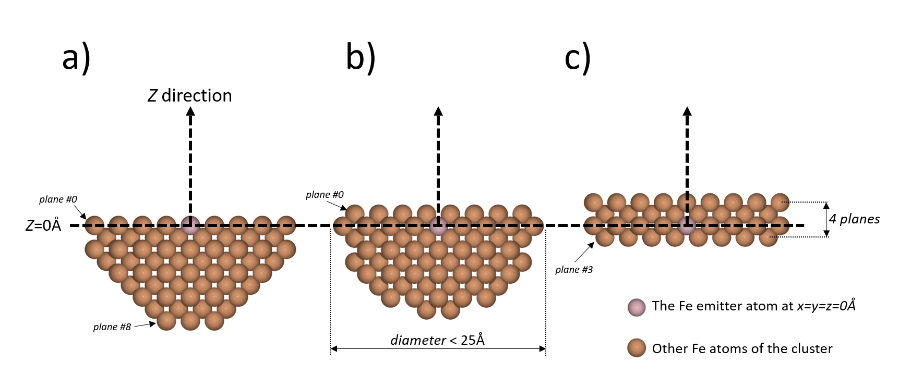
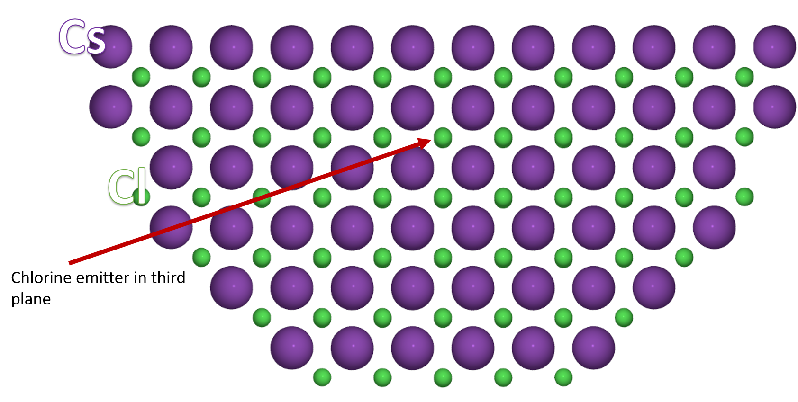

.. _hemispherical_cluster_faq:

The hemispherical_cluster function
----------------------------------

A the :py:func:`hemispherical_cluster` takes one mandatory argument and 4 keyword arguments.
The first required argument is an ASE Atoms object. This object will be the base pattern used to create a cluster.
It is usually a primitive cell of a structure. The 4 keywords arguments describe the dimensions of the cluster and
the location of the emitter atom:

- emitter_tag: is an integer which is the tag of the emitter atom
- emitter_plane: is an integer to tell in which plane to put the emitter
- diameter: is the diameter of the hemispherically shaped cluster (in angströms)
- planes: is the total number of planes

Three simple example are shown in the figure 1 below. These are cut view in the (xOz) plane of the clusters. the
clusters were created with those commands:

.. code-block:: python

        from msspec.utils import hemispherical_cluster
        from ase.build import bulk

        iron = bulk('Fe', cubic=True) # The base cell to be repeated to shape a cluster
        # The cluster 1a, with an emitter on the surface
        cluster1a = hemispherical_cluster(iron, diameter=25, emitter_plane=0)
        # The cluster 1c, with an emitter in the second plane
        cluster1b = hemispherical_cluster(iron, diameter=25, emitter_plane=1)
        # The cluster 1c, with an emitter in the third plane and with just one plane below
        # the emitter
        cluster1c = hemispherical_cluster(iron, diameter=25, emitter_plane=2, planes=4)

    Figure 1.

The *emitter_tag* keyword is used to specify the emitter in a multielemental structure or if two atoms of the same
kind exist in the primitive cell with different chemical or geometrical environment. For example, the CsCl structure
is also *bcc* like the iron above, but the chlorine atom is at the center of a cube with 4 Caesium atoms on the apex.
To get a Cl emitter in the desired plane, we should first tag it in the cell:

.. code-block:: python

        from msspec.utils import hemispherical_cluster
        from ase.spacegroup import crystal

        # Definition of this cubic cell
        a0 = 2.05
        a = b = c = a0
        alpha = beta = gamma = 90
        cellpar = [a, b, c, alpha, beta, gamma]
        # Create the CsCl structure with the crystal function
        CsCl = crystal(['Cs', 'Cl'], basis=[(0,0,0),(0.5,0.5,0.5)], spacegroup=221, cellpar=cellpar)
        # by default, all atoms tags are 0
        # set the Cl tag to 1
        CsCl[1].tag = 1
        # Create a cluster with the Cl emitter
        cluster = hemispherical_cluster(CsCl, emitter_tag=1, emitter_plane=3, diameter=25)

The resulting cluster is shown in the figure 2 below

    Figure 2. A cut view in the (xOz) plane of a CsCl cluster with a Cl emitter atom in the third plane

