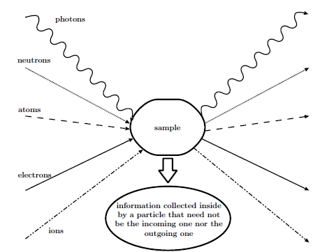
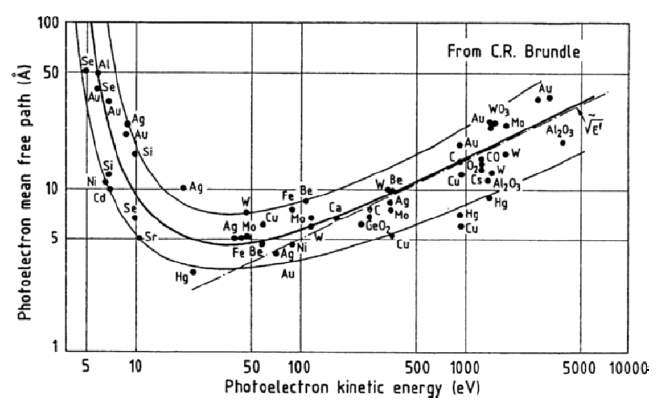
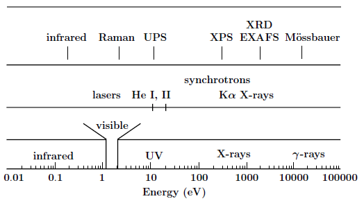

############
Introduction
############

Spectroscopies are among the most widely used techniques to study the physical
and chemical properties of materials. They are now extensively present in many
fields of science such as physics, chemistry or biology. The term
“spectroscopy” which was still characterizing the study of light by means of a
prism in the 19th century, has now, since the advent of quantum theory, a much
wider meaning. Indeed, according to the 15th edition of The New Encyclopaedia
Britannica, “spectroscopy is the study of the absorption and emission of light
and other radiation, as related to the wavelength of the radiation”. If we add
scattering to the two previous physical processes, the quantum nature of
particles makes this definition cover most types of experiment that can be
performed nowadays. Such a typical experiment is sketched below. It should
be noted that the incoming and outgoing particles are not necessarily the same.
When they are of an identical nature, the corresponding technique can be
performed either in the reflection or in the transmission mode.

        Typical spectroscopic experiment

The idea behind these spectroscopies is that information about the sample can
be obtained from the analysis of the outgoing particles. Depending on the type
of spectroscopy, this information can be related to the crystallographic
structure, to the electronic structure or to the magnetic structure of the
sample. Or it can be about a reaction that takes place within the sample.  With
this in mind, the type and energy of the detected particles will directly
determine the region of the sample from which this information can be traced
back, and therefore the sensitivity of the technique to the bulk or the
surface.  For instance, low-energy electrons or ions will not travel much more
than ten interatomic distances in a solid while electromagnetic radiations will
be able to emerge from much deeper layers. In diffraction techniques using
significantly penetrating particles, surface sensitivity can nevertheless be
achieved with grazing incidence angles. Note also that the counterpart to
detecting particles with a small mean free path is the necessity to work under
ultra high vacuum conditions so that the outgoing particles can effectively
reach the detector. The figure below gives the variation of the electron mean free path
:math:`\lambda_e` in solids as a function of the electron kinetic energy. We see
clearly here that in the range 10–1000 eV, electrons coming from within a
sample do not originate from much deeper than 5 to 20 Angströms.
As a consequence, spectroscopies detecting
electrons in this energy range will be essentially sensitive to the surface structure
as the particle detected will carry information from the very topmost
layers.

        The electron mean free path as a function of the energy

Although, as we have just seen, many techniques can provide information
on a sample and its surface (if any), we will mainly restrict ourselves here
to some of them specifically related to synchrotron radiation: x-ray spectroscopies.
X-ray spectroscopies are characterized by the fact that the incoming
beam is composed of photons in the range of about 100 eV to 10 keV. Higher
energies, in the :math:`\gamma`-ray region, will not be considered here as in this latter range
photons will be scattered significantly not only by the electrons but also by
the nuclei [2] giving rise to entirely different spectroscopies such as Mössbauer
spectroscopy. The next, taken from [3], gives a sketch of the electromagnetic
spectrum with some common photon sources and the spectroscopies corresponding
to the various energy ranges.

        The electromagnetic spectrum, along with the common photon sources and
        some spectroscopies based on photons.

.. seealso::

        *This introduction is taken from:*

        X-ray and Electron Spectroscopies: An Introduction
                Didier Sébilleau, Lect. Notes Phys. **697**, p15–57 (2006)
                `[doi] <http://link.springer.com/chapter/10.1007/3-540-33242-1_2>`__

        *For a more complete theoretical background about multiple scattering, see (and references herein):*

        Multiple-scattering approach with complex potential in the interpretation of electron and photon spectroscopies
                D. Sebilleau, R. Gunnella, Z-Y Wu, S Di Matteo and C. R. Natoli,
                J. Phys.: Condens. Matter **18**, R175-228 (2006)
                `[doi] <https://doi.org/10.1088/0953-8984/18/9/R01>`__

        *For a description of the MsSpec code package, see:*

        MsSpec-1.0: A multiple scattering package for electron spectroscopies in material science
                D. Sébilleau, C. R. Natoli, G. M.Gavaza, H. Zhao, F. Da Pieve and K. Hatada,
                Comput. Phys. Commun., **182** (12), p2567-2579 (2011)
                `[doi] <https://doi.org/10.1016/j.cpc.2011.07.012>`__

