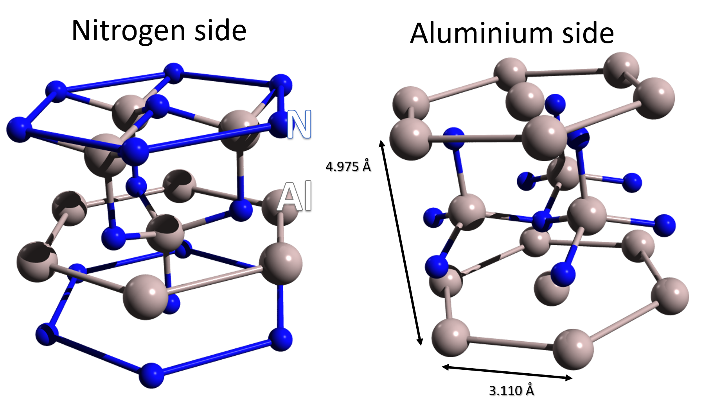
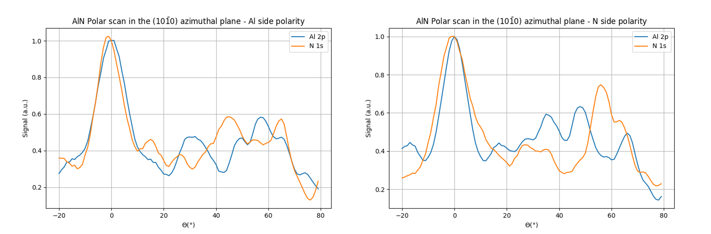
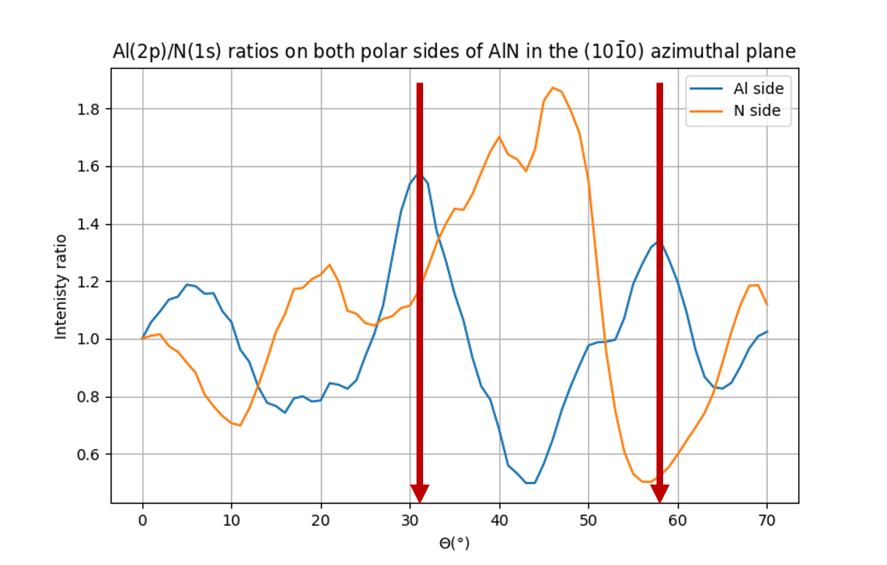

Computing a substrate XPD signal: the AlN polarity example
==========================================================

.. |AlN4| replace:: AlN\ :sub:`4`

In this tutorial, we will see how to compute the full XPD signal of a substrate. In a photoelectron diffraction
experiment, the collected electrons come from a lot of emitters that are located in different planes of the structure
at different depths.

Simply put, getting the total signal from a substrate from a given type of emitter is computing the signal for the
emitter at the surface, at the subsurface, in the 3rd plane... etc, and summing all together.

This task can be tedious since it requires to create as many clusters as needed by the number of planes to compute.
Clusters may be different from one to another because you do not need all the planes if the emitter is at the surface
for example and also because the emitter has to be located at the center of the surface to preserve as much as possible
the symmetry.

A function called :py:func:`hemispherical_cluster` is very handy for that purpose. Before diving into a the more
realistic example of aluminium nitride, you may read more about how to use this function in the FAQ section
:ref:`hemispherical_cluster_faq`.

In a work published in 1999, Lebedev *et al.* demonstrated that Photoelectron diffraction can be used as a non
invasive tool to unambiguously state the polarity of an AlN surface. Aluminium nitride cristallizes in an hexagonal
cell and the authors experimentally showed that the polarity of the surface can be controlled by the annealing
temperature during the growth. Both polarities are sketched in the figure 1 below.

    Figure 1. AlN hexagonal lattice in the left) N polarity with nitrogen terminated surface and |AlN4|
    tetrahedrons pointing downward and right) Al polarity with aluminium terminated surface and |AlN4|

In this work, the authors studied the Al(2p) and N(1s) diffraction patterns for both polarities and they demonstrated
that the Al(2p)/N(1s) ratio exhibits 2 clear peaks at 32° and 59° polar angle in the (10-10) azimuthal plane only for
the aluminium side.

We will attempt to reproduce these results in the multiple scattering approach. In the AlN cell there are 2 Al atoms
and 2 Nitrogen atoms that are non equivalent. To compute the polar scan of a bulk AlN with those 2 variants, we need
to create one cluster for each non equivalent emitter in each plane. We chose to work with 8 planes, so we have to
compute the polar scan for 32 AlN clusters. The total signal for a polar scan will be the sum of all the scans with
the same kind of emitter in each plane.

The code is splitted in different functions. The function :py:func:`AlN_cluster` allows to create an AlN cluster
through the use of the :py:func:`hemispherical_cluster` function by specifing the surface termination and the
direction of the |AlN4| tetrahedrons. This function is used by the second function called :py:func:`create_clusters`
which returns a list of clusters to use for the calculation of a substrate with the desired polarity and emitter
chemical symbol. The function :py:func:`compute_polar_scans` does the calculation of a polar scan for a list of
clusters and save all results in a file called all_polar_scans.hdf5. Finally, the :py:func:`analysis` function performs
the sum of all the data and add a new dataset with the 3 figures reported in figures 2 and 3 below.

        Figure 2. Polar scans in the (10-10) azimuthal plane of AlN for Al polarity (left) and N polarity (right).

        Figure 3. Al(2p)/N(1s) intensity ratio for both polarities.

As can be seen in figure 3, the peaks at 32° and 58.5° are well reproduced by the calculation for an Al polarity.
Some discreapancies arise between the experimental work and this simulation especially for large polar angles. This
may be due to the use of a too small cluster in diameter for the deeper emitters.

The full code of this tutorial can be downloaded :download:`here<AlN.py>`

.. seealso::

        The polarity of AlN films grown on Si(111)
                V. Lebedev, B. Schröter, G. Kipshidze & W Richter, J. Cryst. Growth **207** p266 (1999)
                `[doi] <https://doi.org/10.1016/S0022-0248(99)00375-9>`__

