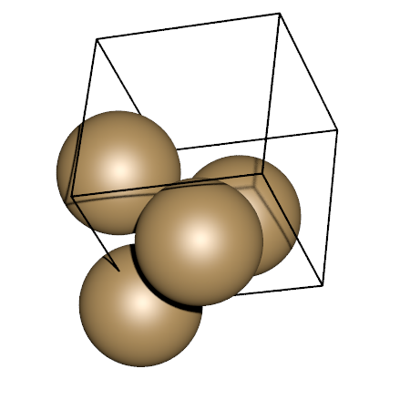
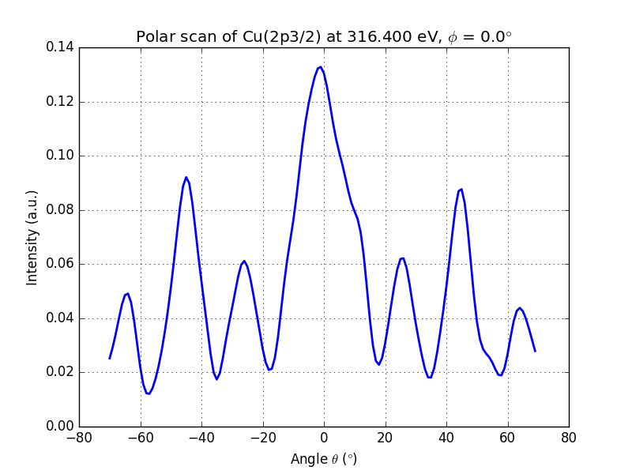

Your first XPD pattern
----------------------
In this small example, you will learn how to produce a polar scan, *ie* you
will plot the number of photo-electrons as a function of the :math:`\theta`
angle. We will do this calculation for a bulk copper (001) surface.

This is a small script of roughly 15 lines (without comments) just to show you
how to start with the msspec package. For this purpose we will detail all steps
of this first hands on as much as possible.

Start your favorite text editor to write this Python script.

Begin by typing:

.. code-block:: python
        :linenos:
        :lineno-start: 1
        
        # coding: utf8

        from msspec.calculator import MSSPEC
        from msspec.utils import *

Every line starting by a '#' sign is considered as a comment in Python and thus 
is ignored... except the first line with the word 'coding' right after the '#'
symbol. It allows you to specify the encoding of your text file. It is not
mandatory but highly recommended. You will most likeley use an utf-8 encoding 
as in this example.

For an MsSpec calculation using ASE, msspec modules must be imported first.
Thus, line 3 you import the MSSPEC calculator from the *calculator* module of the
*msspec* package. MSSPEC is a class.

We will also need some extra stuff that we load from the *utils* module (line
4).

We need to create a bulk crystal of copper atoms. We call this a *cluster*.
This is the job of the *ase* module, so load the module

.. code-block:: python
        :linenos:
        :lineno-start: 6
        
        from ase.build import bulk
        from ase.visualize import view

	a0 = 3.6 # The lattice parameter in angstroms

	# Create the copper cubic cell
	copper = bulk('Cu', a=a0, cubic=True)
        view(copper)

In line 6 we load the :py:func:`bulk` function to create our atomic object and,
in line 7, we load the :py:func:`view` function to actually view our cluster.

The creation of the cluster starts on line 12. We create first the copper cubic
cell with the The :py:func:`bulk` function. It needs one argument which are the 
chemical species ('Cu' in our example). We also pass 2 keyword (optional) arguments 
here:

        * The lattice parameter *a* in units of angströms.
        * The *cubic* keyword, to obtain a cubic cell rather than the fully
          reduced one which is not cubic

From now on, you can save your script as 'Cu.py' and open a terminal window in
the same directory as this file. Launch your script using 'python' or 'msspec -p' 
(depending on your installation):

.. code-block:: bash

        python Cu.py

or

.. code-block:: bash

	msspec -p Cu.py

and a graphical window (the ase-gui) should open with a cubic cell of copper
like this one:

        Figure 1.

Obviously, multiple scattering calculations need more atoms to be accurate. Due
to the forward focusing effect in photo-electron diffraction, the best suited
geometry for the cluster is hemispherical. Obtaining such a cluster is a
straightforward process thanks to the :py:func:`utils.hemispherical_cluster` function.
This function will basically create a cluster based on a pattern (the cubic copper
cell here).

Modify your script like this and run it again.

.. literalinclude:: Cu.py
        :linenos:
        :lineno-start: 1
        :lines: 1-13

Don't forget to add the line to view the cluster at the end of the script and run 
the script again. The :py:func:`hemispherical_cluster` works in 3 simple steps:

	#. Repeat the given *pattern* in all 3 directions
	#. Center this new set of atoms and cut a sphere from the center
	#. Remove the upper half of the created 'sphere'.

To get more information about how to use this function, have a look at the :ref:`hemispherical_cluster_faq` section in the :ref:`faq`.

.. figure:: Cu_fig2.png
        :align: center
        :width: 60%

        Figure 2. The different steps to output a cluster.
        a) After repeat, b) after cutting a sphere, c) final cluster

Once your cluster is built the next step is to define which atom in the cluster
will absorb the light. This atom is called the *absorber* (or the *emitter* since
it emits the photoelectron). 

To specify which atom is the absorber, you need to understand that the cluster
object is like a list of atoms. Each member of this list is an atom with its
own position. You need to locate the index of the atom in the list that you want
it to be the absorber. Then, put that number in the *cluster.absorber* attribute

For example, suppose that you want the first atom of the list to be the
absorber. You would write:

.. code-block:: python
        
        cluster.absorber = 0

To find what is the index of the atom you'd like to be the absorber, you can
either get it while you are visualizing the structure within the ase-gui
program (select an atom with the left mouse button and look at its index in the
status line). Or, you can use :py:func:`utils.get_atom_index` function. This function 
takes 4 arguments: the cluster to look the index for, and the x, y and z coordinates.
It will return the index of the closest atom to these coordinates. In our
example, as we used the :py:func:`utils.hemispherical_cluster` function to create our
cluster, the *emitter* (*absorber*) is always located at the origin, so defining it
is straightforward:

.. literalinclude:: Cu.py
        :linenos:
        :lineno-start: 15
        :lines: 15-16

That's all for the cluster part. We now need to create a calculator for that
object. This is a 2 lines procedure:

.. literalinclude:: Cu.py
        :linenos:
        :lineno-start: 18
        :lines: 18-22

When creating a new calculator, you must choose the kind of spectroscopy you
will work with. In this example we choose 'PED' for *PhotoElectron Diffraction*.
Other types of spectroscopies are:

        - 'AED' for *Auger Electron Spectroscopy*
        - 'APECS' for *Auger PhotoElectron Coincidence Spectroscopy*
        - 'EXAFS' for *Extended X-Ray Absorption Fine Structure*
        - 'LEED' for *Low Energy Electron Diffraction*

Now that everything is ready you can actually perform a calculation. The lines
below will produce a polar scan of the Cu(2p3/2) level with default parameters,
store the results in the data object and display it in a graphical window.

.. literalinclude:: Cu.py
        :linenos:
        :lineno-start: 24
        :lines: 24-28

running this script will produce the following output

        Figure 3. Polar scan of copper (2p3/2)

You can clearly see the modulations of the signal and the peak at :math:`\theta
= 0°` and :math:`\theta = 45°`, which are dense directions of the crystal.

By default, the program computes for :math:`\theta` angles in the -70°..+70°
range. This can be changed by using the *angles* keyword.

.. code-block:: python
        
        #For a polar scan between 0° and 60° with 100 points
        import numpy as np
        data = calc.get_theta_scan(level = '2p3/2', theta = np.linspace(0,60,100))

        # For only 0° and 45°
        data = calc.get_theta_scan(level = '2p3/2', theta = [0, 45])

You probably also noticed that we did not specify any kinetic energy for our 
photoelectron in this example. By default, the programm tries to find the binding
energy (:math:`E_b`) of the choosen level in a database and assume a 
kinetic energy (:math:`E_k`) of

.. math::
        E_k = \hbar\omega - E_b - \Phi_{WF}

where :math:`\hbar\omega` is the photon energy, an :math:`\Phi_{WF}` is the
work function of the sample, arbitrary set to 4.5 eV.

Of course, you can choose any kinetic energy you'd like:

.. code-block:: python
        
        # To set the kinetic energy...
        data = calc.get_theta_scan(level = '2p3/2', kinetic_energy = 300)

        

Below is the full code of this example. You can download it :download:`here
<Cu.py>`

.. literalinclude:: Cu.py
        :linenos:

.. seealso::

        Atomic Simulation Environnment
                `Documentation <https://wiki.fysik.dtu.dk/ase/python.html>`_
                of the ASE module to create your clusters much more.
        X-Ray data booklet
                `Electron binding energies <http://xdb.lbl.gov/>`_ are 
                taken from here.
                

