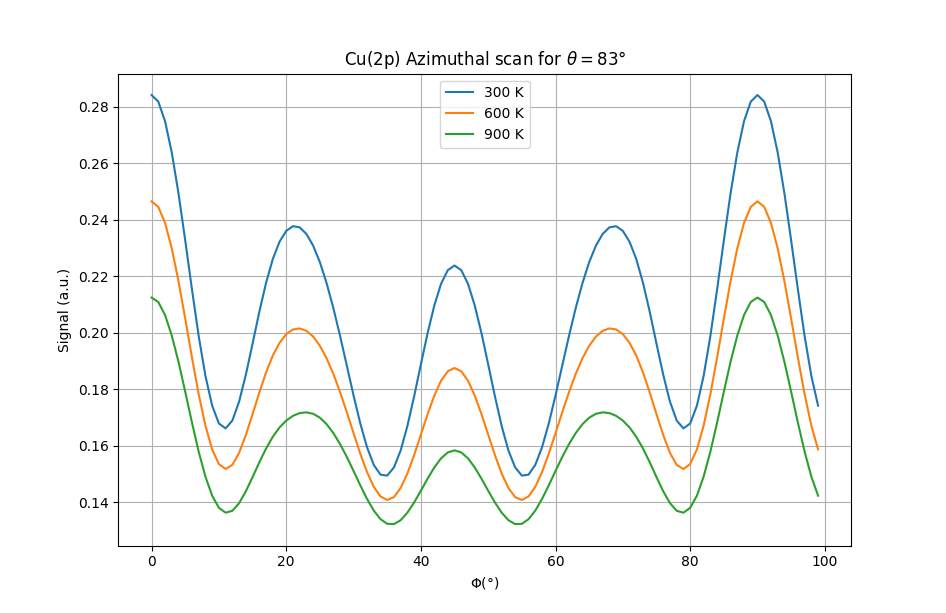
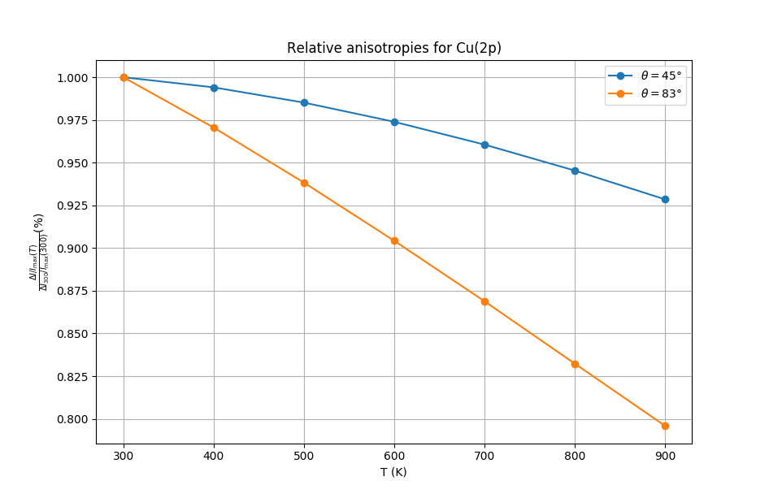

Let's raise the temperature
---------------------------

In this tutorial we will learn how to introduce lattice vibrations in the calculation. Indeed, vibrational
damping can greatly change the result of a calculation since it adds incoherence that will damp the modulations
of the signal.

This was experimentally shown back to 1986 for example by R. Trehan and S. Fadley (see reference below). In their
work, they performed azimutal scans of a copper(001) surface at 2 different polar angles: one at grazing incidence
and one at 45° for incresing temperatures from 298K to roughly 1000K.

For each azimutal scan, they looked at the *anisotropy* of the signal, that is:

:math:`\frac{\Delta I}{I_{max}}`

This value is representative of how clear are the modulations of the signal. As it was shown by their
experiments, this anisotropy decreases when the temperature is increased due to the increased disorder
in the structure coming from thermal agitation. They also showed that this variation in anisotropy is more
pronounced for grazing incidence angles. This is related to the fact that surface atoms are expected to
vibrate more than bulk ones. They also proposed single scattering calculations that reproduced well these
results.

We propose here to reproduce this kind of calculation to introduce the parameters that control the
vibrational damping.

    Azimutal scans for Cu(2p) at grazing incidence and at 45°.

    Variation of anisotropy as a function of temperature and polar angle.

.. literalinclude:: Cu_temperature.py
    :linenos:

Here is the full script used to generate those data (:download:`download <Cu_temperature.py>`)

.. seealso::

        Temperature dependence x-ray photoelectron diffraction from copper: Surface and bulk effects
                R. Trehan & C. S. Fadley, Phys. Rev. B **34** (10) p1654 (1986)
                `[doi] <https://doi.org/10.1103/PhysRevB.34.6784>`__

